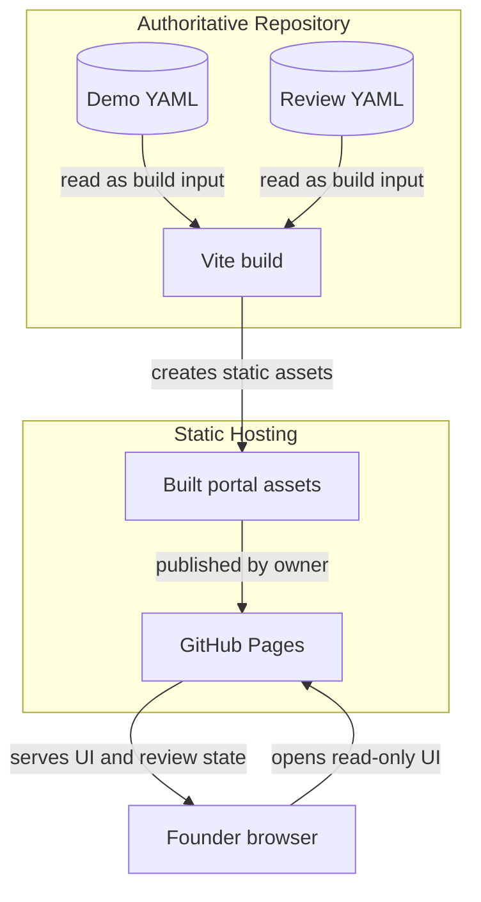
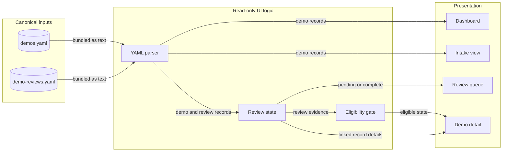

# Founder Review Portal Architecture

> **Status update:** This earlier portal design is superseded for Phase 3.1A. The existing prototype is now a temporary, local workflow workbench, not an approved production portal. Use [the current workbench architecture](founder-review-workbench.md) and [current workbench wireframes](founder-review-workbench-wireframes.md) as the active design. The deployment and write-workflow material below is future exploration only.

## Purpose

Provide a simple browser interface for demo intake and founder review while keeping the Suno repository as the sole system of record. The portal is a read-only projection of canonical metadata, not a second catalog or an approval authority.

## Scope

Phase 3.1A includes a static dashboard, a read-only intake summary, a demo review queue, and an individual demo detail view. It shows review and founder-review state and applies a conservative, testable classification eligibility gate. It does not create or edit records.

Out of scope are authentication, audio upload or playback, external submissions, classification or seed decisions, disposition changes, write-back, background automation, GitHub Actions, and deployment.

## User Journeys

### Dashboard

1. Open the portal and see the number of registered demos, pending founder reviews, completed reviews, and demos eligible to enter classification.
2. Select a demo in the review queue to inspect its evidence and current status.

### Demo Intake

1. Open the intake view to inspect known identifiers, source links, intake status, and missing evidence.
2. Follow links to the repository record and intake standard when source details need correction.
3. Do not enter or submit data in the MVP; intake remains a repository change reviewed through the normal workflow.

### Review Queue and Individual Demo

1. Search or filter registered demos by identifier, title, creator, review state, or disposition.
2. Open one demo to view canonical metadata, linked review records, evidence, and provenance.
3. Treat N/R and UNKNOWN as unresolved, not as negative evaluations or approval.

### Future Classification and Seed Qualification

After a qualifying founder review, a future version may present separate classification and seed workflows. Each decision must include evidence and a rationale, and must remain a reviewable repository change. The Phase 3.1A portal only reports whether the prerequisite review gate is met; it does not make or imply those decisions.

## Recommended Architecture

<!-- mermaid-checked: no \n, no em-dash/en-dash, no {} in labels, subgraphs are id["label"], arrows are -->|"label"|, all subgraphs closed by end, ids unique -->

### Component Relationships

<!-- mermaid-checked: no \n, no em-dash/en-dash, no {} in labels, subgraphs are id["label"], arrows are -->|"label"|, all subgraphs closed by end, ids unique -->

### Technology Recommendation

Recommend Option A: plain HTML, CSS, and JavaScript with Vite for local development and static bundling, plus `js-yaml` to parse the repository's YAML inputs. The build imports the canonical registry files directly; no manually maintained JSON or browser-side metadata copy is added.

| Option | Complexity | Maintainability | Cost | Supportability | Repository fit |
|---|---|---|---|---|---|
| A. GitHub Pages, HTML, CSS, JavaScript | Low; small build tool and YAML parser | High for this narrow workflow; logic stays in small modules | No hosting charge for a public repository | Uses standard browser code and a small dependency set | Reads the existing YAML directly |
| B. GitHub Pages, React | Medium; framework, component model, and build conventions | Good if the portal grows into a large interactive application | No hosting charge for a public repository | More dependencies and framework upgrades than this MVP needs | Works, but adds no current workflow value |
| C. Static-site framework such as Astro | Medium; framework conventions and build setup | Good for larger content-heavy sites | No hosting charge for a public repository | Adds a framework and plugin lifecycle | Useful if portal content expands, premature for this read-only MVP |

| Layer | Technology | Version | Purpose |
|---|---|---|---|
| User interface | HTML, CSS, JavaScript | Browser standards | Read-only dashboard, queue, intake, and detail views |
| Local development and build | Vite | 8.x | Serve and bundle the static portal |
| YAML parsing | js-yaml | 5.x | Parse canonical registries imported at build time |
| Source data | Repository YAML | Current branch | Authoritative demo and review records |
| Hosting target | GitHub Pages | GitHub service | Future static hosting; not configured or deployed in this phase |

### Repository Integration and Data Flow

The portal imports `catalog/metadata/demos.yaml` and `catalog/metadata/demo-reviews.yaml` as raw build inputs. `js-yaml` parses their existing `demo_records` and `review_records` collections. The built JavaScript contains a deploy-time snapshot derived from those files; generated build output is disposable and must never be edited as a source record. A new build is required to reflect repository changes.

| Portal value | Source |
|---|---|
| Demo identity, intake state, source, disposition, classification, seed | `demo_records` in `catalog/metadata/demos.yaml` |
| Review type, reviewer role, founder-review state, grades, written evidence | Linked `review_records` in `catalog/metadata/demo-reviews.yaml` |
| Review Pending or Review Complete | Derived conservatively from linked review evidence; not stored as a new field |
| Classification Eligible | Derived from a qualifying completed founder review; eligibility does not assign a classification |

No separate metadata database, JSON registry, local storage, or editable browser cache is created. The portal links users to the authoritative repository files and keeps the original registry paths in the build source.

### Review State and Governance Controls

A review counts as complete for the portal only when a linked review has `founder_review_status: complete`, a reviewer role identifying the founder, a known reviewer ID, a parseable review date, `audio_reviewed: true`, at least one rateable letter grade, and written non-N/R category evidence. Missing or malformed values leave the state pending. This is a conservative presentation gate, not a replacement for human review or repository validation.

`Classification Eligible` means only that the required review gate is met and classification may be considered. It does not approve any value. The classification and seed fields in the demo registry remain authoritative and require their own evidence and rationale. The UI also flags a classification or seed value that appears before its review gate is met.

### Authentication Assumptions

The MVP has no sign-in or authorization. GitHub Pages serves static files and does not provide application authentication. If the repository or published site is public, the portal and its embedded registry snapshot are public. Do not publish private, sensitive, or legally restricted data. GitHub repository permissions remain the control for changing source records.

The free GitHub Pages path generally requires a public repository. Confirm repository visibility, owner policy, and data suitability before enabling publication. A GoDaddy domain is optional and is not required for local use or the initial Pages site.

### Security Considerations

- The MVP contains no credentials, secrets, write API, upload path, analytics, or third-party runtime script. Repository links open separately with `noopener noreferrer`.
- Registry values are rendered as text, never interpreted as HTML. Keep this invariant for all future repository-controlled fields.
- The YAML parser and build dependencies are version-locked; use `npm ci` for repeatable installs and review dependency updates before merging.
- A static public site is not a confidentiality boundary. Review all source data before publishing, and do not rely on obscurity of the URL.
- Use GitHub Pages HTTPS and verify custom-domain ownership before enabling DNS. The portal itself does not configure TLS or DNS.

### Source-of-Truth Rules

1. `catalog/metadata/demos.yaml` and `catalog/metadata/demo-reviews.yaml` remain authoritative.
2. Portal state is derived from the two registries and is never edited independently.
3. A portal build is a static snapshot; rebuild after source changes.
4. Markdown profiles and plans remain governed supporting records; the portal does not replace them.
5. Unknown values stay `UNKNOWN`; the UI must not infer missing facts.

### Validation Controls

- Parse both YAML registries during application initialization and show an explicit error if parsing or expected record collections fail.
- Validate linked demo and review identifiers before deriving a state.
- Keep review-completion and eligibility logic in a pure, unit-tested module.
- Use text rendering for repository-controlled strings; do not interpret registry content as HTML.
- Run the unit tests and production build before publishing.
- In a future write phase, validate schema and governance rules again at the repository boundary; client checks alone are not authorization.

### Future Write Workflow and Ownership

Phase 3.1A does not write back. The future write path should preserve the repository as the sole authority:

1. The portal gathers a draft and validates required fields locally without claiming approval.
2. An authenticated, least-privilege GitHub integration creates a branch and proposed YAML/Markdown changes; it must not commit directly to `main`.
3. Automated checks parse YAML, validate identifiers and references, and enforce review gates.
4. A founder reviews the change in a pull request; merge creates the authoritative record.
5. A new static build then reflects the merged source.

A browser-held personal access token or secret is not acceptable. A secure GitHub App or equivalent server-side identity will be required for write-back, which justifies revisiting the no-server constraint only in a later phase. No credential, server, workflow, automation, or write path is introduced now.

Ownership boundaries remain unchanged: the founder owns review conclusions and approval; repository maintainers own source changes and merge controls; the portal owns only presentation and client-side validation.

### GitHub Pages Readiness

The source is under `portal/`; `npm run build` produces disposable static output in `portal/dist/`. The Vite build uses relative asset paths so the site can work at a project path or custom domain. No deployment configuration is enabled by this change.

For a future deployment, configure **Repository Settings > Pages > Build and deployment > Source: GitHub Actions** and have a reviewed deployment workflow publish only `portal/dist/`. This phase intentionally does not create that workflow or deploy the site. Before publishing, verify repository visibility and approve the public-data exposure. A custom GoDaddy domain can be added later through Pages' custom-domain setting and the DNS records Pages specifies; do not configure DNS until deployment is approved.

## Future Roadmap

1. Phase 3.1B: approve a write-back security model, GitHub identity, PR-only permissions, schema validation, and audit requirements.
2. Phase 3.1C: implement the approved write workflow with tests and human approval; keep repository merges authoritative.
3. Later: add audio-preservation links and classification/seed workflows after their governance and evidence requirements are approved.
4. Separately: configure Pages deployment and optional custom-domain DNS after privacy and publication review.

## Validation Summary and Known Limitations

The MVP is read-only and has no authentication, upload, backend, database, write-back, GitHub Actions, or deployment. The founder-review gate is intentionally conservative and cannot determine the quality or sufficiency of evidence; a human must decide that. The application build captures a snapshot of the YAML inputs, so publishing requires rebuilding after source changes.

Validation completed: the four focused review-state tests pass, Vite builds the static MVP successfully, and browser checks confirmed the dashboard, pending-review state, read-only detail and intake views, search, filtering, and a narrow viewport without page-level horizontal overflow. Both registries are imported directly; no hand-maintained metadata copy was introduced. GitHub Pages settings and public exposure remain unconfigured.

## Recommended Next Phase

Proceed to Phase 3.1B for a security and governance design of PR-based write-back, including GitHub App permissions, identity, review approvals, YAML/schema checks, and audit evidence. Do not enable data entry or publish sensitive repository content until that design is approved.
